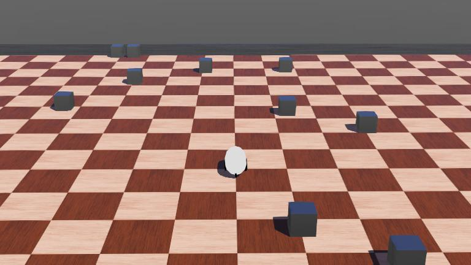

# LiDAR Object Avoidant Robot in Webots

Simulasi robot penghindar rintangan (*object avoidant robot*) menggunakan sensor **LiDAR** pada simulator **Webots**.



## Struktur Project
- `worlds/lidarCapsul.wbt` : File environment/dunia simulasi Webots.
- `controllers/lidarCapsul/lidarCapsul.py` : Kode program pengendali robot berbasis Python.

## Cara Menjalankan Simulasi
1. Clone atau download repository ini:
   ```bash
   git clone https://github.com
   ```
2. Buka aplikasi **Webots**.
3. Klik **File > Open World...** lalu pilih file `worlds/lidarCapsul.wbt`.
4. Jalankan simulasi dengan menekan tombol **Play** pada toolbar Webots.
